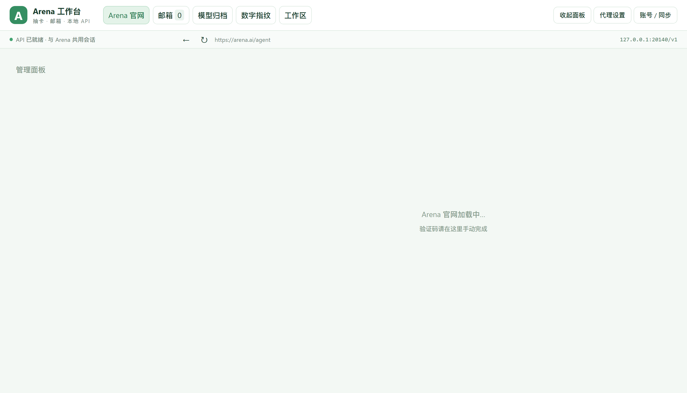

# Arena 工作台

> 一个把 [Arena](https://arena.ai) 官网装进自己窗口里的 Windows 桌面工作台。
> 抽到的模型不再是一次性的——它变成一个能保留、能切换、能调用的账号资产。

---

## 它到底解决什么问题

在 Arena 上抽卡，抽到好模型靠运气。但抽到之后呢？

- 记录在哪？
- 这个模型属于哪个号？
- 号被风控了怎么办？
- 想把这段对话拿到别的 AI 里继续，只能复制粘贴？

**Arena 工作台把这些接了起来**：一个号 = 一个独立环境 = 一套模型池 = 一条代理线路，
全部在同一个窗口里管理，互相不串。



---

## 九大功能

### 一、多账号切换（右上角「账号 / 同步」）

一个 Arena 账号 = **一间独立的房**。cookie、登录态、会话、模型池全部隔离，互不相通。

```
「账号 / 同步」→ 填新邮箱 → 打开独立登录环境
              → 右边登录官网   → 点「同步当前登录」
```

- 切换过多少个号，就保留多少套登录环境，重启不清空
- 每个号的模型池独立，不会混在一起
- **抽卡或 API 任务运行中不要切换账号**

### 二、邮箱池（统一取验证码）

去闲鱼之类的渠道买**批量邮箱**，导进来就能用：

```
「邮箱」→ 导入 → 一行一个：邮箱----密码
             或：邮箱----密码----Client ID----刷新令牌
```

- 单次最多导入 2000 行
- 导入后自动识别服务商，直接打开对应网页收件箱
- 注册 / 登录时用它取验证码，不用来回切浏览器

> 账号多了以后，靠手动切邮箱是不现实的。这是多号玩法的基础设施。

### 三、一号一节点（右上角「代理」）

**核心是防风控**：让每个号的出口 IP 固定且互不相同。

两种用法：

| 方式 | 做法 | 适用 |
|---|---|---|
| **导入节点** | 粘贴节点列表 → 每个号绑定一个节点 | 号多、要隔离 |
| **指向本机代理** | 直接填 `http://127.0.0.1:端口` | 图省事，不用导入 |

- 绑定关系持久化，重启不丢
- 有「检测」按钮，切换前先验节点通不通
- 不绑定 = 走系统默认网络，所有号共用一个出口

### 四、收起面板，当官网用（右上角「收起面板」）

点一下，左边的管理面板收起来，整个窗口就是**干净的 Arena 官网**。

用不惯管理面板的时候，它就是你的日常浏览器。再点一次展开。

### 五、左边两个区：管理区 / 工作区

#### 管理区 —— 抽卡与模型池

**每个号一个独立的管理区**，互不相通。

- **模型归档**：已识别 / 未识别的会话池，可选用、体检、复检、归档、解除绑定
- **连抽采集**：抽卡中心。选 1 / 2 / 3 轮，或勾「持续抽取直到命中目标」
- **多选目标模型**：Ctrl / Shift 多选，可设「命中任意一个就停」或「全部命中才停」

**指纹识别怎么做的**：向会话发一组探针提示，从回答的数值特征、推理路径、token 偏好里
比对指纹库，判断背后是哪个模型。命中后自动把会话名改成 `[指纹推测] xxx`。

**指纹库有个「检查并更新参考库」按钮**，能一键同步上游项目的最新指纹数据。

> 每轮之后那个「此任务成功了吗？」弹窗由系统自动点掉，不用管。

#### 工作区 —— 你自己加的东西

这一区是个人化的，放的是日常要用的入口：

- 打开工作台目录
- 启动 / 停止 / 状态：隧道与 MCP
- **冷启动包**：复制 / 一键发送到当前会话
- **接力包**：抓本机 AI 会话，打包发给网页 AI
- 导出 / 导入对话

### 六、冷启动包：让网页 AI 连上你的机器

**这是整个项目最核心的一步**：网页里的 AI 没有本地权限，给它一段文本，它就能自己把隧道搭起来。

工作区第 3 步有四个按钮：

| 按钮 | 发的是什么 | 什么时候用 |
|---|---|---|
| **发送到当前会话** | 主包（带已生成的私钥） | 自己的对话，一键发进去 |
| **复制冷启动包** | 主包，复制到剪贴板 | 想粘到别处 |
| **发送备用包到当前会话** | 备用包（不含私钥） | 对方不接受私钥的对话 |
| **复制备用冷启动包** | 备用包，复制到剪贴板 | 同上 |

AI 拿到之后自己完成三件事：

1. 建 SSH 隧道连到你这台机器
2. 接入本机全能 MCP（36 个工具）
3. 开始读写文件、跑命令、开浏览器

> ⚠️ **主包等同于你电脑的钥匙。** 里面是明文私钥，只发给你自己信任的对话，
> **永远不要贴进公开的地方、不要提交到仓库、不要发给别人。**
> 要给别人用，走**备用包**——它让对方的 AI 自己生成一对密钥，把公钥交给你填进面板。

**给你的同学装机**：把**备用包**给他，让他照
[`docs/安装教程.md`](docs/安装教程.md) 走。他需要自己的 VPS，你的隧道帮不了他。

### 七、本地接力：把本机 AI 的活接到网页上

工作区里的「接力包」会自动扫描本机 AI 代理（Agent）的会话数据：

| 来源 | 位置 |
|---|---|
| ZCode | `~/.zcode/cli/db/db.sqlite` |
| Codex | `~/.codex/sessions` |
| Claude Code | `~/.claude` |
| WorkBuddy | `~/.workbuddy` |

```
「刷新会话列表」→ 选一个会话 → 「复制接力包」或「发送到当前会话」
```

它把那段对话整理成一份带上下文的交接文本，贴给网页 AI 就能**接着做**，不用从头解释。

**为什么快**：本机 AI 干活快但能力有限，网页 AI 能力强但每次都要重述背景。
接力把两者接起来，各干各擅长的。

### 八、导出 / 导入对话

对话聊久了想搬走？

- **导出当前对话**：抓取页面数据，整理成可保存的文本
- **导入到新对话**：把导出的内容送到新会话里继续

和油猴脚本干的是同一件事，只是不用装脚本。

### 九、鹈鹕测试（小趣味）

工作区里有个「发送绘画指令」，让当前模型画一只骑自行车的鹈鹕。

为什么留这个？**鹈鹕画得好，模型大概率不差。** 指纹识别要抽好几轮才知道结果，
但让它画张图，你一眼就能感觉出成色。纯属好玩，不参与评分。

---

### Linux / macOS（社区路径）

后端与桥接是跨平台的：进入 `app/` 目录执行 `bash install.sh`（同样自动生成随机密钥），然后 `npm run desktop` 启动。
C# 启动器仅 Windows 提供；该路径未像 Windows 一样全面实测，遇到问题先看 [常见问题](docs/常见问题.md)。

## 还有一个本地 API（可选，默认不用）

工作台本身是个 OpenAI 兼容接口：`http://127.0.0.1:20140/v1`

| 端点 | 用途 |
|---|---|
| `GET /v1/models` | 列出可选模型 |
| `POST /v1/chat/completions` | 对话，支持流式 |

**但说实话**：把网页对话包装成 API 再给本地 Agent 调用，**延迟太高，不好用**。
这个功能保留着，但日常更推荐直接在工作台里操作。

---

## 文档导航

按需要看，不用全读。

| 文档 | 讲什么 | 什么时候看 |
|---|---|---|
| **本页** | 能干什么、九大功能速览、怎么装 | 第一次了解这个项目 |
| [**安装教程**](docs/安装教程.md) | **从零到跑通**。硬件条件、目录整理、VPS、密钥、冷启动包全在里面 | **装的时候就照这一份做** |
| [界面与功能详解](docs/界面与功能详解.md) | 每个按钮、每个参数怎么用 | 装了想用某个功能 |
| [常见问题](docs/常见问题.md) | 现象 → 原因 → 怎么办 | 哪里不对劲 |
| [架构说明](docs/架构说明.md) | 内部结构、数据流、代码分布 | 改代码或深度排障 |

---

## 安装

### 前置

- Windows 10 / 11
- Node.js **20 或更高**（[nodejs.org](https://nodejs.org/) 选 LTS 版，一路默认安装）

### 四步装好

```powershell
# 1. 下载（没有 git 就在 GitHub 点 Code → Download ZIP 解压）
git clone https://github.com/mello7711/arena-workbench.git
cd arena-workbench

# 2. 改名摆好（必须做，程序里路径写死了）
$root = "C:\Arena工作台"
New-Item -ItemType Directory -Path $root -Force | Out-Null
Move-Item .\app    (Join-Path $root "主程序")    -Force
Move-Item .\bridge (Join-Path $root "隧道与MCP") -Force
$t = Join-Path $root "隧道与MCP"
Copy-Item .\docs\coldstart\冷启动包-躯壳版-主.txt   (Join-Path $t "冷启动包-主.txt")   -Force
Copy-Item .\docs\coldstart\冷启动包-躯壳版-备用.txt (Join-Path $t "冷启动包-备用.txt") -Force

# 3. 一键安装（装依赖 + 下载 Electron + 生成配置，约 5 分钟）
cd $t\..\主程序
powershell -ExecutionPolicy Bypass -File install-windows.ps1

# 4. 启动
.\start-gui.bat
```

**就这四步。** `.env` 里的密钥由脚本随机生成，不用你填任何东西。

> ⚠️ **第 2 步不能跳过。** 直接 `cd app` 装完也能开窗口、能抽卡，
> 但「启动隧道」和「发送到当前会话」两个按钮会失效——
> 程序第 5 行把 `TUNNEL_DIR` 写死成 `工作台根\隧道与MCP`，
> 第 262 行从那里读冷启动包。目录改名、txt 搬家改名，两件都做了按钮才活。

> **第 4 步不是 `启动工作台.cmd`。** 仓库里没有这个文件——
> 它是装好之后**你自己在自己机器上**做的快捷方式，随便叫什么。
> 仓库里能双击启动的是 `主程序\start-gui.bat`。
>
> **没有 git？** 在 GitHub 页面点 `Code → Download ZIP`，解压后 `cd` 进解压出来的目录，
> 从第 2 条命令开始。

### 安装脚本做了什么

| 步骤 | 检查什么 | 失败时 |
|---|---|---|
| 1 | Node.js ≥ 20 | 告诉你去哪装 |
| 2 | `npm ci` 装依赖 | 列出四种常见原因（网络/代理/权限/公司网络） |
| 3 | Electron 运行时 + `icudtl.dat` | 自动补装，还不行就教你手动命令 |
| 4 | 生成 `.arena-gui\.env` | 已存在就不动，除非加 `-Force` |

**它是幂等的**，重复运行不会破坏已有配置。装坏了就重跑。

### 装完之后

1. 右侧页面登录你的 Arena 账号
2. 想抽卡：左边「管理」→「连抽采集」
3. 想用隧道和 MCP（**可选**）：把 `冷启动包-主.txt` 发给网页里的 AI

> 隧道和 MCP 是「让网页 AI 能操作你电脑」才需要的。
> 只用抽卡、管邮箱、切账号的话，**完全不用配**。
>
> 详细步骤看 [安装教程.md](docs/安装教程.md)，装不上看
> [常见问题.md](docs/常见问题.md)。

### 仓库目录 vs 装好之后的目录

**这两个不是一套名字，看文档时容易对不上，先记住这张表：**

| 仓库里叫什么 | 装好之后叫什么 | 作用 | 能删吗 |
|---|---|---|---|
| `app/` | `主程序/` | 工作台本体（Electron + 后端服务） | 不能 |
| `bridge/` | `隧道与MCP/` | SSH 隧道、MCP 服务、看门狗、Python 运行时 | 不能 |
| — | `选妃资料/` | 你自己的资料 | 可以 |

**改名不是可选的美化，是程序写死的。** `main.cjs` 第 5 行：
`TUNNEL_DIR = 工作台根\隧道与MCP`，隧道脚本和冷启动包都从这里找。
不改名、不搬文件，工作台能开能抽卡，但隧道和冷启动那两个按钮是坏的。

改法：跑一条命令 `fix-layout.ps1` 自动摆好，见 [安装教程](docs/安装教程.md)。

---

## 需要自己准备的东西

这个仓库里**没有**、也需要你自己弄的：

| 项目 | 说明 |
|---|---|
| Arena 账号 | 自己注册，能登录就行 |
| Node.js 20+ | 跑工作台本体，必装 |
| **VPS（想要远程控制才需要）** | **必须有公网 IP。这一项没有替代品** |
| Python 3.10+ | 只想抽卡不用装；要跑 MCP 服务才需要 |
| SSH 密钥 | 走备用包时由 AI 自己生成；主包用的是已有的那把 |
| 代理节点（可选） | 多号防风控才需要 |

**占位符不用手填。** 跑 `fix-layout.ps1 -Configure`，它会问你要几个值，
然后自动替换掉所有 `{{...}}`、生成 SSH 配置、把公钥填好，最后打印你在 VPS 上要执行的命令。

**准备给第二台电脑装之前，先看 [安装教程](docs/安装教程.md) 第 0 步**——
它会告诉你哪一步是硬门槛、哪一步其实可以跳过。

---

## 参考与致敬

这个项目站在别人的肩膀上，明确列出：

| 来源 | 用途 | 许可 |
|---|---|---|
| [Ikaleio/lm-detector](https://github.com/Ikaleio/lm-detector) | 模型指纹识别算法与参考库 | MIT |
| [Gandhara2077/arena-local-bridge](https://github.com/Gandhara2077/arena-local-bridge) | 项目雏形（本地 API 桥接思路） | MIT |

指纹库的引擎和参考数据来自 `lm-detector`，通过官方 `lmfpd-sdk` 接入。
内置的 `bank.json` 是该项目某一时点的快照，可以点「检查并更新参考库」同步到最新。

> 指纹识别是**闭集统计推断**：参考库标签和准确率未经独立验证；
> 同一会话多轮的结果与独立参考条件有差异。把它当作参考，不是定论。

更多声明见 [NOTICE.md](NOTICE.md)。

---

## 遇到问题

看 [常见问题.md](docs/常见问题.md)，按「现象 → 原因 → 怎么办」查。

---

## 许可

MIT，见 [LICENSE](LICENSE)。
